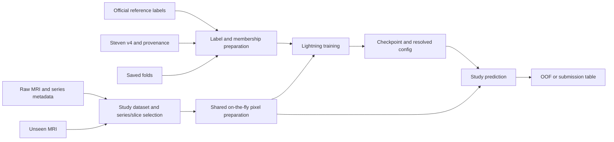

# Competition repository architecture

Decision recorded on **2026-09-10**: optimize this repository for quick, traceable
competition experiments. Launch commands from the repository root. Separate
the maintained workflow in `scripts/pipeline/`, reusable utilities in
`scripts/tools/`, and one-off work in `scripts/adhoc/`.
Keep shared modules in `src/knee_abnormality/`, YAML configs validated with
Pydantic in `configs/`, and prepare image pixels on the fly for v1. `uv` manages
dependencies and installs the local package in editable mode through setuptools.

The baseline uses [Steven v4](public-label-audit.md#implication-for-the-first-baseline)
and the [all-study five-fold protocol](validation.md#project-validation-protocol).
Each fold holds out about 20% of all studies, without assigning folds by gold
status. The old reference-only split remains available for baseline1 reproduction.
The maintained baseline config uses a ReXNet-200 NAV ImageNet encoder with
three-channel adjacent slice triplets; the latest completed baseline3 artifact
uses ResNet50D RA2. Both pool usable acquisitions within each plane–contrast
slot, favor central triplets, and apply target-specific attention MIL across
all retained inputs. Validation doubles the configured per-series raw-slice
limits without changing training or test limits. The
[modeling notes](modeling.md#implemented-baseline) record the chosen
backbone, raw-slice limits, 224-pixel crops at 0.625 mm, clipping quantiles
`[0.005, 0.995]`, checkpoint-specific normalization and training defaults.

Prefer Lightning's built-in training, precision, optimization and callback
facilities wherever they fit this workflow. `LightningModule`,
`LightningDataModule`, `Trainer`, `ModelCheckpoint`, `EarlyStopping` and
`CSVLogger` manage the current training lifecycle. timm's public APIs select
the encoder and weights. The current backbone follows Lightning's training
transition and updates BatchNorm statistics; saved configs may instead select
evaluation-mode BatchNorm and timm activation checkpointing.

## Where code belongs

Start with the [script index](../scripts/INDEX.md) to find existing commands
before adding code. The repository's
[scripts-maintainer skill](../.agents/skills/scripts-maintainer/SKILL.md)
defines discovery and catalog maintenance. Each runnable script has one
catalog entry; detailed usage and findings stay in their topic docs.

Training and prediction entry points live in `scripts/pipeline/`.
Shared setup functions handle metadata/label preparation; a separate
`prepare.py` command is unnecessary. Reusable
support tools live in `scripts/tools/`; one-off investigations belong in
`scripts/adhoc/`. Shared modules belong in `src/knee_abnormality/` and use
imports such as `from knee_abnormality.config import load_config`. Add a
shared module when real code needs it, and split a growing file by
responsibility when that makes editing easier.

| Location | Responsibility | Status |
|---|---|---|
| `src/knee_abnormality/config.py` | Validate YAML with Pydantic, resolve paths, apply overrides and print effective settings | Implemented |
| `src/knee_abnormality/cli.py` | Define the shared explicit-only `pydantic-settings` policy for runnable CLIs | Implemented |
| `src/knee_abnormality/runtime.py` | Configure the CUDA allocator and move tensor batches between devices | Implemented |
| `src/knee_abnormality/provenance.py` | Stream and hash files used by audits, checkpoints, bundles and experiment records | Implemented |
| `src/knee_abnormality/metrics.py` | Compute per-target and macro AUC plus validation subgroup metrics | Implemented |
| `src/knee_abnormality/profiling.py` | Select bounded profile datasets and record reproducible profiling artifacts | Implemented |
| `configs/baseline.yaml` | Selected inputs, preprocessing, model, optimization, runtime, seed, paths, and development fold | Implemented |
| `scripts/INDEX.md`, `scripts/**/catalog.yaml` | Script discovery, usage metadata and index maintenance | Implemented; inventories live in the catalogs |
| `scripts/tools/` | Reusable acquisition, validation and repository utilities | Implemented; see the [catalog](../scripts/tools/catalog.yaml) |
| `scripts/adhoc/` | Metadata/label investigations, environment probes and future exploration | Implemented; see the [catalog](../scripts/adhoc/catalog.yaml) |
| `src/knee_abnormality/labels.py` | Polars joins, source fingerprints, gold/silver provenance and fold membership | Implemented |
| `src/knee_abnormality/checkpoints.py` | Validate saved preprocessing/input/model/target semantics and fingerprint actual training inputs for resumption | Implemented; historical checkpoints require archived code or bundles |
| `src/knee_abnormality/preprocessing_identity.py` | Fingerprint dataset, preprocessing, augmentation and model sources with fixed sampling and spatial-token semantics | Implemented; required at prediction, validation, resume and export |
| `src/knee_abnormality/preprocessing/dicom.py` | Parse headers into plain values, validate native descriptors, read selected frames and retain pydicom fallback and recoverable exceptions | Implemented |
| `src/knee_abnormality/preprocessing/series.py` | Index metadata-only slice records, exclude known bad instances, order/center physical positions and sample slices or triplets | Implemented |
| `src/knee_abnormality/preprocessing/geometry.py` | Retain compact native pose layouts, validate series center lines, solve the plane-balanced study reference and diagnose per-series projections | Implemented; pure geometry with no I/O or labels |
| `src/knee_abnormality/preprocessing/spatial.py` | Crop/pad geometry, bounded sparse-filter cache, float32 resampling and delayed affine application | Implemented |
| `src/knee_abnormality/preprocessing/intensity.py` | Exact float32 quantile selection and in-place NumPy normalization | Implemented |
| `src/knee_abnormality/preprocessing/preparation.py` | Decode selected records, accept complete groups, collect acquisition-wide quantiles and construct tensors; retain decoder injection for profiling | Implemented |
| `src/knee_abnormality/augmentation.py` | Sample and apply shared affine, gamma/contrast and noise transforms for training and previews | Implemented |
| `src/knee_abnormality/dataset.py` | Set up the series index; select series and slices, prepare and collate inputs, and construct configured data loaders | Implemented |
| `src/knee_abnormality/model.py` | One-pass spatial ReXNet features, guarded series dropout and target-specific study MIL | Implemented; spatial-token MIL is the active model |
| `src/knee_abnormality/spatial_tokens.py` | Verified backbone anchors, independent visual/3D masks, coordinate and metadata embeddings, study-level 3D dropout | Implemented; fixed spatial-token path |
| `scripts/pipeline/train.py` | Lightning module/data loading, optimizer, checkpoints, validation outputs and training entry point | Implemented; baseline3 fold 0 completed, with earlier checkpoint corrections recorded in the [baseline review](baseline-review.md#implemented-corrections) |
| `scripts/pipeline/predict.py` | Load saved model/config, predict studies, write validation/submission tables | Implemented |
| `scripts/pipeline/export.py` | Build an atomic, hash-inventoried checkpoint/code/wheel bundle and generated inference notebook | Implemented; artifact checks remain checkpoint-specific |
| `scripts/pipeline/submit.py` | Version the private bundle, run the offline notebook, verify output and submit the exact successful version | Implemented; requires explicit remote IDs and a ready bundle |
| `justfile` | Expose the four maintained train, export, infer and submit commands without embedding Python orchestration | Implemented |
| `notebooks/` | Optional visual inspection and short investigations that call shared code | Create when needed; submission notebooks are generated inside bundles |
| `docs/` | Decisions, procedures, evidence, and work tracking | Implemented |
| `data/`, `outputs/` | Downloaded inputs, prepared metadata/labels and generated experiment artifacts | Local and Git-ignored |

This table defines responsibilities; planned files are not empty scaffolds.
The preprocessing package has an empty `__init__.py`; callers import each owner
directly. `dataset.py` owns worker-local index lifetime and study/acquisition
selection, study-reference and center-projection diagnostic caches. Slice records retain
native XYZ tuples and share repeated orientation/spacing/layout descriptors.
Native-pose validity, study-reference acceptance and sampling projection remain
separate decisions; 3D requires accepted series geometry and study reference.
DICOM byte interpretation stays in `dicom.py`; spatial and intensity
modules perform no file I/O. Descriptors retain scalar metadata only, while
selected pixels are decoded afresh on every load. Reader dispatch is fixed,
with no configuration flag or persistent pixel/header cache. See the
[integration evidence](data-preparation.md#production-dicom-integration) for
layout limits, equivalence checks, performance and per-worker memory bounds.

Keep experiment logic explicit. A new backbone or pooling alternative can be
a small constructor/function in `src/knee_abnormality/model.py`; it does not
need a plugin registry or a parallel copy of the training loop. Put runnable
behavior behind a main guard so scripts can also expose useful functions.

### Shared geometry contract

`SliceRecord` retains each native XYZ position and provenance (`patient`,
`slice_location`, `instance_number` or `filename`). `NativePose` shares repeated
`PoseLayout` values containing the two original orientation axes, pixel spacing,
dimensions and frame ID. Native values are not rounded to a representative pose.
`IndexedSeries` adds bounds, pose validity, orientation/center-line consistency
and rejection reasons. `StudyReference` records an accepted point or explicit
unavailability, contributors, conditioning, plane-balanced residuals and frame IDs.
`CenterProjection` records each series' diagnostic projection or rejection reason.
The worker index caches compact CPU values without pixels or dense grids.
Prepared triplets carry per-channel crop-to-patient maps, series/native reliability and
valid rectangles. Collation aligns geometry tensors with image masks and study
slots; the model composes the executed augmentation transform on each forward.

The [sampling experiment](validation.md#2026-09-12-accurate-centers-result)
selected midpoint sampling. Projections are diagnostics only and do not change
triplet selection, physical position encoding or the centered image crop.
Native pose validity, reference acceptance and an in-range projection remain
distinct: a projection outside a stack does not invalidate its native poses.
Different cross-series frame IDs are recorded, not automatically rejected.
The fixed [screening thresholds](data-preparation.md#accurate-sampling-centers)
are not bounds on local registration error. Spatial tokens retain visually valid observations with unknown 3D; position-aware
selection does not establish registration or local anatomical correspondence.

### Geometry and fusion comparison sequence

The shared geometry foundation and accurate-centers comparison are complete.
The frozen fusion control is the submitted `crop140mm` checkpoint/bundle and
midpoint recipe identified in [validation](validation.md#2026-09-12-accurate-centers-result).
Use its saved config, seed, input/label/split identities and predictions; the
mutable baseline YAML is not its recipe. Historical checkpoints run through
their archived source/bundles and never receive invented preprocessing identities.
The spatial-fusion stage was implemented, profiled and
[rejected at the deployment runtime gate](validation.md#2026-09-12-spatial-fusion-engineering-result).
The user subsequently selected the original 27-query, width-64 architecture
with eager execution, later replaced by the [spatial-token model](modeling.md#active-spatial-token-model).
The reduced compiled variant remains archived. The selected sampler and
submitted model remain the frozen comparison control; their historical
measurements do not establish an accuracy result for the restored implementation.

### Maintained workflow versus ad-hoc work

`scripts/pipeline/` contains the commands used to reproduce a baseline and prepare a
submission. Improve these commands as the solution evolves; avoid accumulating
variants such as `train_v2.py` or `predict_final_fixed.py`. Select experiment
variants through configs and shared model code.

`scripts/tools/` contains reusable supporting commands: `download_data.py`
handles acquisition and resumption; `validation.py` creates fixed folds and
scores OOF predictions across experiments. Keep their arguments and outputs
stable as the pipeline develops. Extract shared functions into
`src/knee_abnormality/` when the training or preparation code needs them.

`scripts/adhoc/` contains focused investigations with descriptive names. The
existing metadata and public-label audits reproduce the evidence in the topic
docs; the environment probe records setup checks. These scripts
can call shared code, but the maintained workflow must not depend on them.
When an investigation becomes part of the solution, move its reusable behavior
into the relevant shared module or maintained entry point. Record useful
findings in the topic docs and keep generated artifacts under `data/` or
`outputs/`, not beside the script.

## Data flow and shared behavior



Label preparation and pixel preparation are independent. Label joins happen
once during setup, not inside `__getitem__`. V1 decodes and prepares pixels
while loading batches; preprocessing behavior follows the saved image recipe.

The dataset can retain multiple usable acquisitions per selected type and
supplies three-channel uint8 inputs containing consecutive slices in overlapping
triplets, validity masks and the agreed metadata. Channel-appearance limits are
divisible by three; positional encoding uses each triplet's middle slice. The
model applies acquisition-consistent augmentation and checkpoint-specific
normalization before the CNN; see [input semantics](modeling.md#three-channel-inputs).
Projected spatial image features receive 1D, 2D, 3D, plane and contrast encodings before
target-specific attention produces twelve study logits. Supervision supplies
twelve targets and observation masks. Keep image padding and absent series
separate from missing target labels.

`preprocessing/sampling.py` owns metadata-only run indexing, union target
sampling, supplier choice and distinct-plane assignment. `geometry.py` owns
the unchanged reference fit. Dataset retries rebuild support after failures;
`preparation.py` decodes and normalizes unique retained slices before gathering
channels. Threaded loading injects decoding only. Fixed sampling rules and source
hashes are part of the strict preprocessing identity; historical runtimes remain
isolated. See [physical sampling](physical-sampling.md#implemented-sampler).

The model consumes the agreed series inputs and returns `[batch, 12]` logits.
Loss is applied after study aggregation. Raw reports, reference labels, file
paths and Polars operations do not belong in the model's forward pass.
Backbone-specific normalization must accompany the selected checkpoint.

Training and prediction share preprocessing, evaluation series/slice selection
and the PyTorch model. Training uses random slice sampling and
[acquisition-consistent augmentation](modeling.md#ten-epoch-schedule-and-augmentation);
evaluation uses a recorded deterministic policy with augmentation disabled.
The generated submission notebook invokes the packaged prediction command and
attaches the required code and weights instead of maintaining a second image
pipeline. It works offline with explicit input and output locations; follow
[submission requirements](inference-efficiency.md#verified-submission-requirements).

## Iteration speed

The pipeline uses on-the-fly pixel preparation without a persistent image cache. Measure
whether loading keeps up with the GPU before adding further infrastructure.

- **Index once.** Keep a study/series index with physical slice order, geometry,
  relative file locations and decode status. Reuse acquisition fingerprints
  and preparation manifests; do not hash every DICOM before each training run.
- **Select before decoding.** Skip absent types and unselected acquisitions.
  Fixed quantile clipping over each series' sampled slices allows decoding only
  those slices; see the
  [preparation notes](data-preparation.md#intensity-and-geometry) for the
  normalization tradeoff.
- **Prepare pixels in loader workers.** Use float32 for spatial/intensity
  arithmetic and fixed percentile clipping, then produce uint8 images.
  Prepare metadata and label arrays outside the batch loop. Tune worker count
  and prefetching from measured study throughput and memory use.
- **Profile before scaling.** Record data-loading time, studies/second, peak
  memory, GPU waiting and total runtime. Mixed precision and compact batches
  are first training candidates. Caching is a deferred option only if loading
  proves to be a bottleneck; compilation and additional models also need
  measured benefit.

Use progressively larger runs for different questions:

| Run size | Purpose | Interpretation |
|---|---|---|
| A few real studies/batches | Inspect decoded anatomy, batching, loss and runtime after a code change | A development execution; no competitive score claim |
| One fixed fold with a recorded budget | Iterate on throughput and screen an experiment affordably | Development evidence; repeated fold-0 tuning is not independent validation |
| All five fixed folds, complete study predictions | Compare promising changes with the same frozen evaluation labels, budget and seed | Pooled AUC on all 4,407 studies, plus separate gold/report-derived and per-target/fold results |

Partial validation batches cannot produce the complete held-out-fold endpoint.
Do not report a partial/single-class AUC as a full score. Use a fixed checkpoint
rule for comparisons. The existing `scripts/tools/validation.py` remains the owner
of final OOF scoring; reuse its metric logic rather than redefine it.

## Configs and development commands

Use one explicit YAML file per experiment. Copy the baseline for a new idea,
change the relevant settings, and retain the effective config with its outputs.
Keep numerical choices in configs, not scattered constants or notebook cells.
Introduce model, optimizer, sampling and runtime fields when those components
are implemented; there is no configuration inheritance framework.

`src/knee_abnormality/config.py` reads YAML with `yaml.safe_load` and validates
it against nested Pydantic models for experiment identity, paths, labels, and
validation settings.
Unknown or missing keys fail clearly; seeds must be integers in `[0, 2**32)`
and fold selections must be nonempty, distinct nonnegative integers. The models
are frozen after validation. Their nesting matches the YAML, for example
`config.labels.source` and `config.validation.folds`.

Use `pydantic-settings` for argument parsing and configuration in new CLIs,
following [project guidance](../AGENTS.md). The current inspection CLI accepts
only explicit arguments and disables environment, dotenv and secrets sources.
The YAML must be valid on its own; explicit overrides then take precedence and
are validated again. Keep this explicit source policy for experiment commands
so a shell environment cannot silently change an experiment.

Current commands, from the repository root:

```bash
rtk proxy uv run --locked python -m knee_abnormality.config configs/baseline.yaml
rtk proxy uv run --locked python -m knee_abnormality.config configs/baseline.yaml --folds 0,1,2,3,4
```

These print resolved settings as JSON, retaining the YAML's nested sections
and adding `config_file` and `split_dir`. They do not create run artifacts,
train or check dataset availability.
The current config selects `steven_v4`, split `all_5fold_v3`, seed 42 and
**fold 0 for quick development**. Selecting one fold does not change the
saved five-fold assignments. Preparation/training must check requested fold
IDs against `protocol.json` and verify the selected label-source fingerprint.

Configured paths are relative to the YAML file, so moving the checkout does
not require absolute paths in version control. `--data-root` and `--output-root`
override machine-specific storage locations; relative CLI overrides use the
current working directory. `label_manifest` points to the pinned source
manifest. Its `data/...` paths refer to the configured data root when consumed
by label preparation. The audit scripts resolve their
documented data and output arguments from the repository root.

`scripts/pipeline/train.py` and `scripts/pipeline/predict.py` use the same config
loader, with explicit CLI overrides for development limits, fold selection,
input/output locations and resume. Extend the schema alongside a new experimental option.

Launch the workflow from the repository root with
`rtk proxy uv run --locked python -m scripts.pipeline.train` or
`rtk proxy uv run --locked python -m scripts.pipeline.predict`, passing that
command's config/options. Run
`rtk proxy uv sync --locked` during setup to install `knee_abnormality` from
`src/` in editable mode. Entry points and notebooks import shared code from
that package. The `-m scripts...` commands locate entry points from the
repository root. Use the same form
for supporting tools and investigations, for example
`rtk proxy uv run --locked python -m scripts.tools.validation --help` and
`rtk proxy uv run --locked python -m scripts.adhoc.audit_metadata --help`.

## Experiment artifacts and reproducibility

Use one fresh directory per run under `outputs/<run_id>/`. Store the copied
input config, effective settings, source/split/preprocessing identifiers, code revision
and dirty-source snapshot, seed and dependency information. A name or Git SHA
alone does not identify an experiment made with uncommitted changes.

Profiling snapshots preserve repository-relative paths under `source/`.
External inputs, including configs, retain their resolved absolute path without
the filesystem root under `source/external/`; `/tmp/profile.yaml` becomes
`source/external/tmp/profile.yaml`. The manifest hashes these files too.

Keep per-fold checkpoints, logs and study predictions under `fold_<k>/`, with
`last.ckpt` for explicit resumption and the recorded selected checkpoint for
comparison. Put combined OOF predictions and metrics at the run root. Start
with local CSV/JSON logging; introduce a tracking service only when useful.
Resuming a run must check its config and input identities; a new experiment
gets a new directory instead of overwriting the previous result.

Best and latest checkpoints have separate callbacks; `last.ckpt` is refreshed
every completed epoch. Checkpoints embed the saved config, target order, fold
and input fingerprints, with the latter also written to `input_identity.json`.
Prediction rejects incompatible input/model settings or target order, and
validation checks the producing fold. Resume also checks numerical training
settings and the original input identities. Legacy checkpoints without those
identities require their archived source/bundle, even for prediction with the
same config. Every new checkpoint and input identity records the preprocessing
algorithm, fixed reliability values and a stable digest of package-relative
`dataset.py`, `model.py`, `augmentation.py`, `spatial_tokens.py` and all preprocessing Python sources. Export validates the actual
copied sources; bundled prediction recomputes the identity without training data.
See [implemented corrections](baseline-review.md#implemented-corrections)
for allowed runtime/storage changes and baseline1 compatibility.

Keep reusable metadata and label tables under `data/`, outside run directories.
Preserve original gold/silver
tables, use gold only for eligible training rows, and exclude held-out report
groups according to the saved manifest. The current split assigns every study
to exactly one validation fold; its complete OOF table has 4,407 rows. The
historical gold-only split's shared silver training pool cannot supply OOF
predictions. See [validation](validation.md) and
[the label audit](public-label-audit.md) for the full protocol.

## Current scope and next execution

The config, fold-aware labels, on-the-fly image preparation, study dataset,
model, training, prediction, export and remote-submission orchestration are
implemented. Existing frozen folds and source files are preserved. Baseline1
is the historical gold-only run; baseline3 is the current all-study fold-0 run.
Their results are recorded in [modeling](modeling.md#implemented-baseline)
and the [baseline1 review](baseline-review.md). Track the remote submission and
remaining folds in [ongoing work](ongoing.md). Use bounded real-data executions
and inspect their artifacts.
