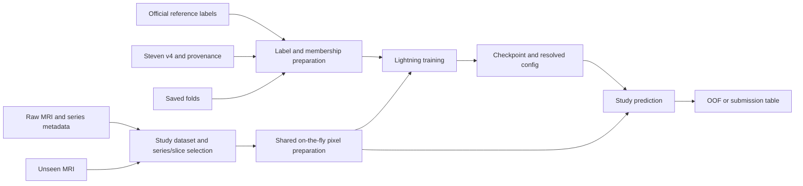

# Data flow and iteration speed

## Data flow and shared behavior

Label preparation and pixel preparation are independent. Label joins happen
once during setup, not inside `__getitem__`. V1 decodes and prepares pixels
while loading batches; preprocessing behavior follows the saved image recipe.

The dataset can retain multiple usable acquisitions per selected type and
supplies three-channel uint8 inputs containing consecutive slices in overlapping
triplets, validity masks and the agreed metadata. Channel-appearance limits are
divisible by three; positional encoding uses each triplet's middle slice. The
model applies acquisition-consistent augmentation and checkpoint-specific
normalization before the CNN; see [input semantics](../modeling/triplet-inputs-and-sampling.md#three-channel-inputs).
Projected spatial image features receive 1D, 2D, plane and contrast encodings before
target-specific attention produces twelve study logits. Supervision supplies
twelve targets and observation masks. Keep image padding and absent series
separate from missing target labels.

`data/preprocessing/sampling.py` owns metadata-only run indexing, union target
sampling, supplier choice and distinct-plane assignment. `geometry.py` owns
the unchanged reference fit. Dataset retries rebuild support after failures;
`preparation.py` decodes the retained slices' raw support blocks, and
`device.py` resamples, normalizes and gathers channels on the batch's device.
Threaded loading injects decoding only. Fixed sampling rules and source
hashes are part of the strict preprocessing identity; historical runtimes remain
isolated. See [physical sampling](../data-preparation/physical-sampling/implemented-sampler.md).

The model consumes the agreed series inputs and returns `[batch, 12]` logits.
Loss is applied after study aggregation. Raw reports, reference labels, file
paths and Polars operations do not belong in the model's forward pass.
Backbone-specific normalization must accompany the selected checkpoint.

Training and prediction share preprocessing, evaluation series/slice selection
and the PyTorch model. Training uses random slice sampling and
[acquisition-consistent augmentation](../modeling/schedule-and-augmentation.md#ten-epoch-schedule-and-augmentation);
evaluation uses a recorded deterministic policy with augmentation disabled.
The generated submission notebook invokes the packaged prediction command and
attaches the required code and weights instead of maintaining a second image
pipeline. It works offline with explicit input and output locations; follow
[submission requirements](../inference/submission-requirements-and-output-contract.md#verified-submission-requirements).

## Iteration speed

The pipeline uses on-the-fly pixel preparation without a persistent image cache. Measure
whether loading keeps up with the GPU before adding further infrastructure.

- **Index once.** Keep a study/series index with physical slice order, geometry,
  relative file locations and decode status. Reuse acquisition fingerprints
  and preparation manifests; do not hash every DICOM before each training run.
- **Select before decoding.** Skip absent types and unselected acquisitions.
  Fixed quantile clipping over each series' sampled slices allows decoding only
  those slices; see the
  [preparation notes](../data-preparation/unverified-preprocessing-notes.md#intensity-and-geometry) for the
  normalization tradeoff.
- **Read in loader workers, finish pixels where there is headroom.** Workers
  read the needed payload rows; float32 resampling, fixed percentile clipping
  and the uint8 images happen in the workers for local training and prediction,
  and on the GPU for Kaggle inference, with identical results. Prepare metadata
  and label arrays outside the batch loop. Tune worker count and prefetching
  from measured study throughput and memory use.
- **Profile before scaling.** Record data-loading time, studies/second, peak
  memory, GPU waiting and total runtime. Mixed precision and compact batches
  are first training candidates. Caching is a deferred option only if loading
  proves to be a bottleneck; compilation and additional models also need
  measured benefit.

Use progressively larger runs for different questions:

| Run size | Purpose | Interpretation |
|---|---|---|
| A few real studies/batches | Inspect decoded anatomy, batching, loss and runtime after a code change | A development execution; no competitive score claim |
| One fixed fold with a recorded budget | Iterate on throughput and screen an experiment affordably | Development evidence; repeated fold-0 tuning is not independent validation |
| All five fixed folds, complete study predictions | Compare promising changes with the same frozen evaluation labels, budget and seed | Pooled AUC on all 4,407 studies, plus separate gold/report-derived and per-target/fold results |

Partial validation batches cannot produce the complete held-out-fold endpoint.
Do not report a partial/single-class AUC as a full score. Use a fixed checkpoint
rule for comparisons. `knee_abnormality.evaluation.scoring` owns final OOF scoring for
both training and `scripts/tools/validation.py score`; reuse its metric logic rather than
redefine it.
