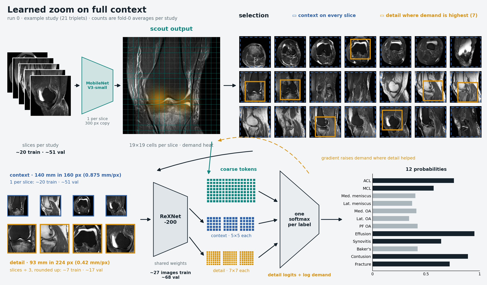

# Crop-selection investigation (2026-09-15 to 2026-09-16)

**Dropped on 2026-09-16.** No run beat the full-slice `00-baseline`, and the code went back to
its recipe ([active model](../modeling/current-model.md)). Two properties decided
the score, not learned placement:

- ReXNet-200 sees most slices.
- It sees them at 0.625 mm or finer.

Learned placement was never worth more than about 0.005. A full-slice test of finer resolution
at a fixed field of view is deferred to the
[end of the competition](../backlog/endgame.md#bigger-images).

The original rationale is in the [implementation plan](crop-selection-plan.md). Documentation
snapshots, source archives and retired scripts are listed in the
[historical crop-selection sources](crop-selection-sources/README.md), including the last
[`docs/ongoing.md`](crop-selection-sources/ongoing.md.txt) with every open option in full.

## Goal

Give ReXNet-200 more detail where abnormalities are, at lower compute than the full-slice
model. Every position-to-head experiment had tied or regressed (knee side, 3D embedding, token
graph, attention prior), so this changed which pixels the backbone sees. A light scout read every
sampled triplet whole at a larger field of view, and its cells became coarse tokens in the
attention pool. The model then cut crops or glimpses for ReXNet-200 and trained everything with
the task BCE alone. The sampler and the triplet count stayed unchanged.

## Runs

Fold 0 of `all_5fold_v3`, seed 42, macro AUC at the selected epoch. The controls are the
full-slice `00-baseline` (0.892763) and the champion (0.892360, public 0.936). All runs used
ReXNet-200 and the MobileNetV3-small scout (`mobilenetv3_small_100.lamb_in1k`). None has a
public score.

| Run | Crops | What ReXNet-200 sees | Macro AUC | vs `00-baseline` | Record |
|---|---|---|---:|---:|---|
| 160 px | One per kept canvas, summed value map, 15-epoch extension | Every slice, 80 mm at 0.5 mm | 0.887151 | −0.0056 | [result](../validation/results/2026-09-15-crop-selection-result.md) |
| Two crops | 160 px, two per kept canvas | Every slice twice, 80 mm at 0.5 mm | 0.889409 | −0.0034 | [result](../validation/results/2026-09-15-two-crops-result.md) |
| crop224 | 224 px on 75% of canvases, summed value map | 75% of slices, 112 mm at 0.5 mm | 0.891624 | −0.0011 | [result](../validation/results/2026-09-16-crop224-result.md) |
| per-label | 224 px on 75%, equal label quotas, union pooling | 75% of slices, 112 mm at 0.5 mm | 0.891703 | −0.0011 | [result](../validation/results/2026-09-16-per-label-crops-result.md) |
| label-private | 2 per label, plane spread, private gated pooling, label FiLM | About a quarter of slices, pooled per label | 0.845131 | −0.0476 | [result](../validation/results/2026-09-16-label-private-crops-result.md) |
| shared | 2 per label, plane spread, shared gated pooling | About a quarter of slices (12.9 of 50.7 validation canvases) | 0.879626 | −0.0131 | [result](../validation/results/2026-09-16-shared-crops-result.md) |
| learned zoom | 160 px context on every slice, learned 224 px detail, one softmax | Every slice at 0.875 mm; detail glimpses at 0.42 mm went unused | 0.869951 | −0.0228 | [result](../validation/results/2026-09-16-learned-zoom-result.md) |

The overnight `crop130` rerun is a separate full-slice test (130 mm at 224 px), a tie at 0.892500
([overnight results](../validation/results/2026-09-15-overnight-results.md)).

## Recipes

The first six runs shared one base:

- **Canvases:** 300 px at 0.5 mm (150 mm), augmented whole per series.
- **Scout:** stride-16 and stride-32 features (624 channels) projected to 256, which gives 361
  coarse tokens per canvas with 1D, 2D, plane and contrast embeddings.
- **Draft:** the shared attention and head on coarse tokens alone, logged as
  `val_draft_macro_auc`.
- **Crops:** integer windows of the augmented canvas, read by ReXNet-200 with the fine token
  scores coupled to their cell's coarse score.

The runs differed as follows:

- **160 px and two crops:**
  - *Value map:* `ŷ(1−ŷ) · ‖w_t‖ · a`, detached and summed over labels.
  - *Placement:* greedy footprint coverage, sampled with Gumbel noise in training.
  - *Pooling:* coarse tokens got a learned per-label offset in the union softmax.
  - *Details:* in the [plan](crop-selection-plan.md).
- **crop224:** 224 px crops, `data.crop_canvas_fraction: 0.75`, at most one crop per canvas.
- **per-label:** each label kept its own value map, and `ceil(0.75 × kept canvases)` crops were
  split into equal label quotas, round-robin.
- **label-private:**
  - *Selection:* exactly two crops per label, the second on another plane when available.
  - *Pooling:* private fine pooling mixed with the shared coarse pool by a per-label gate.
  - *Conditioning:* a zero-initialised label FiLM at ReXNet-200's `features.10`.
- **shared crops:** every label pooled all 24 crops, FiLM was removed, and the attention prior
  was retired. The full recipe and shape diagram are in the
  [shared-crops snapshot](crop-selection-sources/active-spatial-token-model.md.txt).

### Learned zoom

Candidate run 0 of the glimpse plan, implemented and trained on 2026-09-16. The full recipe,
profile and shape diagram are in the
[learned-zoom snapshot](crop-selection-sources/learned-zoom-active-spatial-token-model.md.txt)
and its [shape diagram](crop-selection-sources/learned-zoom-model-shapes.md.txt).

- **Canvases:** 360 px at 0.4167 mm (150 mm). The scout read a 300 px antialiased downsample.
- **Context:** one centred 336 px (140 mm) window per canvas, read at 160 px (0.875 mm, 5×5
  tokens).
- **Detail:** `min(ceil(0.333 × canvases), candidates)` glimpses per study, 224 px at
  0.4167 mm (93 mm, 7×7 tokens). On fold 0 that was 7.0 per training study and 17.4 per
  validation study at 2× images.
- **Selection:**
  - *Demand:* a per-label head, `softplus(MLP)` on coarse tokens, starting at 1.
  - *Coverage:* greedy label-weighted facility location with per-study spherical k-means over
    detached scout features (16 clusters, latent coverage 0.5).
  - *Sampling:* Gumbel-max on log gain in training, argmax in evaluation.
- **Pooling:** one float32 softmax per label over coarse, context and detail tokens. Each detail
  token's logit added its glimpse's log mean demand, which was demand's only gradient.
- **Cost:**
  - *Epoch:* 246–262 s including validation.
  - *Memory:* peak 22.4 GiB. A random-initialisation profile of the eight heaviest training
    studies took 0.426 s and 17.9 GiB for 6 studies and 0.486 s and 20.9 GiB for 7, and ran out
    of memory at 8.

## What the runs established

These are single-seed fold-0 results.

- **Zoom helps central targets, and the losses are at the edges.**
  - *Per-label gains against `00-baseline`:* ACL +0.0111, synovitis +0.0077 and medial OA
    +0.0057.
  - *Per-label losses:* lateral meniscus −0.0102, fracture −0.0085, MCL −0.0064 and Baker's cyst
    −0.0039.
  - *Why:* the uncropped canvases were mostly edge slices, and fracture pairs are the most
    expensive
    ([pair costs](../validation/target-level-diagnostics.md#cost-of-a-reversed-pair)).
- **Slice coverage matters more than per-label targeting at 224 px.** Score followed how many
  canvases ReXNet-200 saw:

  | ReXNet-200 input | Runs | Macro AUC |
  |---|---|---:|
  | Every slice | `00-baseline` | 0.8928 |
  | 75% of slices | crop224, per-label | 0.8916–0.8917 |
  | About 13 of a study's 51 validation canvases | shared (per-label crops about 38) | 0.8796 |
  | The same coverage, pooled privately | label-private | 0.8451 |

  Four crops per label at inference recovered 0.003 of shared's 0.012 gap to per-label. This is
  a pattern across runs, not a controlled run
  ([shared crops](../validation/results/2026-09-16-shared-crops-result.md#reading)).
- **Resolution matters as well as coverage.**
  - *Learned zoom:* ReXNet-200 evidence was in effect at 0.875 mm on every slice. The lateral
    meniscus fell 0.106, MCL 0.067 and ACL 0.022 against `00-baseline`, while effusion (+0.006)
    and contusion held.
  - *Comparison:* `00-baseline` reads every slice at 0.625 mm, and per-label read 75% at 0.5 mm.
  - *Caveat:* the architectures differ, so this is not a controlled resolution test
    ([learned zoom](../validation/results/2026-09-16-learned-zoom-result.md#reading)).
- **Selection adds little because the value map is weak.**
  - *Learned against fixed placement:* learned placement beat uniform and centred 160 px crops
    by about 0.005. Training on learned crops inflated that gap
    ([placement ablation](../validation/results/2026-09-15-crop-selection-result.md#placement-ablation)).
  - *Attention against random selection:* on the label-private checkpoint with shared pooling,
    attention beat random selection by 0.004. A label's attention on its chosen canvas had a
    normalised entropy of 0.97–0.99
    ([probe](../validation/results/2026-09-16-label-private-crops-result.md#selection-signal-probe)).
  - *Per-label placement:* crop centres of studies with and without a finding differed by only
    0.1–3.6 mm ([placement](../validation/results/2026-09-16-per-label-crops-result.md#placement)).
  - *Learned zoom:* removing or randomising the detail glimpses changed nothing.
- **A trained coarse pool made placement study-specific only while fine pooling was weak.**
  - *Label-private:* its gated coarse pool reached 0.82, against 0.61–0.71 for the other runs'
    drafts. Its crop centres for positive and negative studies differed by up to 14.5 mm.
  - *Shared fine pooling:* the pool fell back to 0.65, and detail labels settled on a fixed lower
    position.
- **Private fine pooling starves ReXNet-200.**
  - *Loss:* label-private lost 0.047 to per-label, most on the menisci and ligaments.
  - *Inference fixes:* more crops or shared pooling at inference recovered at most 0.004.
  - *Learned mixing:* the gate (0.505–0.537) and label FiLM (mean |scale| about 0.02) barely
    moved.
- **Misses can be recognition failures.** A detected fracture relied on crops that other labels
  chose. A missed one lay inside other labels' crops and was not recognised
  ([renders](../validation/results/2026-09-16-per-label-crops-result.md#visual-review-of-fracture-cases)).
- **Averaging a crop model with the champion added about as much as a second full-slice run**
  (+0.00036 more for per-label crops). See the
  [ensembles](../validation/results/2026-09-16-per-label-crops-result.md#ensembles-with-the-full-triplet-models)
  and [two-crops averaging](../validation/results/2026-09-15-two-crops-result.md#per-target-comparison-with-the-champion).

## Rejected approaches

- **Private fine pooling and label FiLM:** see the
  [label-private result](../validation/results/2026-09-16-label-private-crops-result.md).
- **Two crops per label with plane spread,** also with shared pooling: see the
  [shared-crops result](../validation/results/2026-09-16-shared-crops-result.md).
- **Selecting by class-activation evidence instead of attention:** it lost 0.0006–0.0023 and aimed
  at bright superficial signal
  ([probe](../validation/results/2026-09-16-label-private-crops-result.md#selection-signal-probe)).
- **Learned zoom as built:** the detail glimpses went unused, and the context resolution cost
  the detail targets.
- **Blaming draft-uncertainty weighting for the peripheral losses:** removing the weighting at
  inference scored +0.000709 and left Baker's cyst and MCL far below the champion
  ([check](../validation/results/2026-09-15-two-crops-result.md#draft-uncertainty-check)).

## Options not pursued

When the investigation stopped, these were open hypotheses with no measured support. The
[ongoing snapshot](crop-selection-sources/ongoing.md.txt) has their full design notes, costs and
risks.

| Option | Idea |
|---|---|
| Learned glimpse sets (the recommended run 1) | Two-scale glimpses, detail at 0.42 mm and context at 0.625 mm, on 0.42 mm canvases. A k-DPP policy over label-weighted facility location, a budget matched to the champion's compute, a demand head, union pooling with log-demand, and matched exploration pairs with per-label swap credit and a Bradley–Terry loss. |
| Glimpse-outcome predictor (run 2) | A JEPA-like head on scout tokens that predicts the ReXNet-200 embedding a glimpse would produce, so selection can estimate each candidate's effect without running the backbone. |
| DINO scout pretraining (run 3) | Self-supervised multi-crop pretraining of the scout on about 175k training canvases, for an anatomy-aware latent space. |
| Anatomical glimpses (run 4) | Detail windows fixed in patient coordinates around the structures (compartments, notch, patellofemoral joint, posteromedial corner, MCL), with no learned placement. The joint line is more than 25 mm from the image centre in 6–16% of series ([input resolution](../research/input-resolution.md#field-of-view-and-joint-position)). |
| Branch fusion (run 5) | A zero-initialised projection of the crop's scout cells into ReXNet-200's `features.10`, plus a canvas-pooled scale and shift ([GLNet](../research/learned-crop-selection.md#global-local-branch-fusion)). |
| Training-only crop jitter | ±1 scout cell (±8 mm). |
| Per-slice canvas centring | Superior axial slices sat off-centre because every canvas was centred on one study point. |
| Several attention heads per label | Listed without a design; now a general idea in the [small changes](../backlog/small-changes.md#attention-pooling). |
| Deferred | Per-label learned prototypes as the coarse attention score, weak location labels from reports, a second selection pass, light token mixing across coarse tokens, and a larger scout ([candidates](../research/scout-backbones.md)). |

The same snapshot records superseded variants: a higher early Gumbel temperature, selection from
the gated coarse pool, a study-dependent gate and a soft per-label bias.

## Engineering lessons

- **Host memory:** 300 px loader queues pushed WSL's 30 GB into the out-of-memory killer twice.
  For the fix and the separate validation loader, see
  [training runtime](../modeling/training-runtime-and-memory.md#host-memory-with-larger-inputs).
- **GPU memory:**
  - *crop224:* 224 px crops on every canvas ran out of memory on the 24 GiB card, while 75% of
    canvases peaked at 21.3 GiB in the heaviest-study profile
    ([crop224](../validation/results/2026-09-16-crop224-result.md#setup)).
  - *Later runs:* label-private, shared crops and learned zoom peaked at 22.4–22.5 GiB.
- **Epoch time:** the simplifications from label-private to shared crops saved nothing. Epochs
  took about 200 s for crop224 and per-label, 234 s for label-private, 237 s for shared crops and
  246–262 s for learned zoom.
- **Backbone costs:** the learned-zoom budget, scout delta formula and scout code requirements
  are in the [backbone-swap snapshot](crop-selection-sources/learned-zoom-backbone-swaps.md.txt).
  The scout survey is in [scout backbone candidates](../research/scout-backbones.md).
