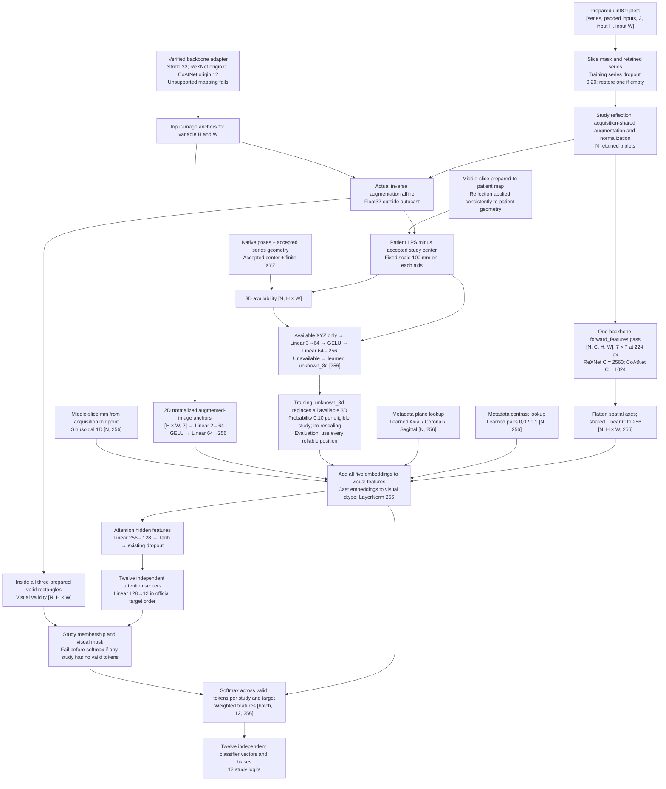

# Spatial-token model shapes

Current [independent-head model](modeling.md#active-spatial-token-model), with
ReXNet selected by the sigma-40 baseline. CoAtNet is a supported alternative.
Historical 1C changes only the readout and classifier grouping described in
[modeling](modeling.md#historical-disease-sharing).

