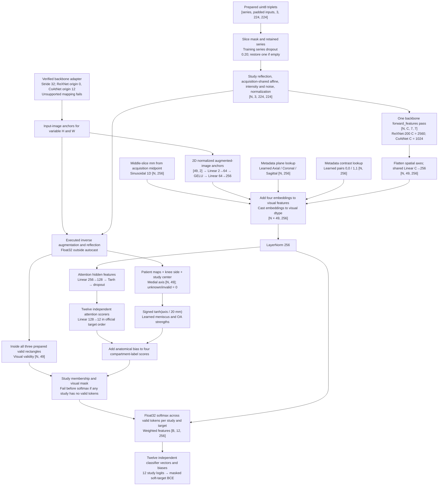

# Spatial-token model shapes

This diagram traces the current [full-slice model](current-model.md) at the
training config's 224 px triplets (0.625 mm, 140 mm). ReXNet-200 is the configured backbone and
CoAtNet a supported alternative. The three slices per input, the 256-wide projection and the
128-wide attention scorer are code constants (`SLICES_PER_INPUT`, `PROJECTION_WIDTH`,
`MIL_ATTENTION_WIDTH`), not config fields.

- **`N`:** retained triplets in the batch.
- **`B`:** studies.

The retired diagrams are elsewhere:

- **Crop selection and learned zoom:** the
  [historical crop-selection sources](../history/crop-selection-sources/README.md).
- **Token graph:** the `00-baseline` run archive and the [model lineage](../history/model-lineage.md#retired-token-graph).
- **Historical 1C:** it changes only the readout and classifier grouping, described in
  [modeling](retired-side-and-compartment-variants.md#historical-disease-sharing).

At 2× validation images, a study with all six series types has up to 64 triplets, which is 3,136
tokens before masking. Batches carry patient maps, geometry validity, knee side and
study-center X as well as valid rectangles. Patient X supplies the compartment attention
bias; visual validity still determines token membership.
